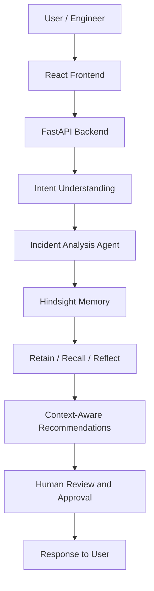

# RunBook AI

### An AI-powered incident response assistant with persistent operational memory

RunBook AI helps engineering teams understand production incidents, investigate possible root causes, and develop safer remediation plans using AI and persistent memory.

Instead of treating every incident as an isolated event, RunBook AI uses **Hindsight memory** to retain relevant incident information, recall historical experiences, and reflect on previously recorded resolutions.

The goal is to make incident response more context-aware, consistent, and human-controlled.

---

## 1. The Problem

Production incidents can be difficult to investigate because:

- Engineers must analyse logs, symptoms, and system behaviour under pressure.
- Similar incidents may have occurred previously, but their resolutions are difficult to find.
- Important operational knowledge can be lost between incidents or team members.
- AI-generated remediation suggestions can be risky if executed without human review.

Traditional AI assistants often lack persistent operational context.

**RunBook AI addresses this problem by combining incident analysis, persistent memory, and human approval workflows.**

## 2. Our Solution

RunBook AI acts as an intelligent incident response assistant.

It can:

- Understand technical questions and incident descriptions.
- Analyse incident symptoms and available evidence.
- Identify relevant historical incidents using Hindsight.
- Generate possible root-cause explanations.
- Recommend remediation steps.
- Maintain incident context across conversations.
- Request human approval for potentially risky operations.

RunBook AI is designed to assist engineers, not replace their judgement.

## 3. Key Features

| Feature | Description |
|---|---|
| Intelligent incident analysis | Analyses incident descriptions and available technical evidence |
| Persistent memory | Retains useful incident information using Hindsight |
| Historical incident recall | Retrieves relevant previous incidents and resolutions |
| Context-aware recommendations | Uses historical experience to inform new recommendations |
| Conversation continuity | Maintains incident context across interactions |
| Human-in-the-loop safety | Requires human review and approval for risky actions |
| Multimodal incident support | Supports incident evidence such as images and logs, where configured |

## 4. Hindsight Integration

Hindsight is a central part of RunBook AI.

It provides persistent memory so the system can use information from previous incidents rather than relying exclusively on the current conversation.

We use three important memory capabilities:

### Retain

Stores useful incident information, evidence, and user-recorded resolution details for future reference.

### Recall

Retrieves relevant historical memories when a new incident is analysed.

### Reflect

Produces higher-level insights from previously stored memories, helping the assistant identify potentially useful historical patterns.

### Example: Persistent Incident Memory

**First incident**

An inventory API experiences HTTP 503 errors, database connection pool utilisation becomes unusually high, and requests begin timing out.

RunBook AI analyses the incident and retains relevant information.

**Resolution record**

A user records that the connection pool configuration was reviewed and corrected.

**Second incident**

A similar inventory API incident occurs.

RunBook AI can recall the previous incident and suggest investigating connection pool utilisation and configuration.

The historical resolution is treated as a reference, not proof that the new incident has the same root cause.

This demonstrates how Hindsight makes incident recommendations more context-aware.

## 5. Safety and Human Approval

RunBook AI follows a human-controlled approach to infrastructure operations.

Its current implementation provides analysis and remediation recommendations; it does not independently execute infrastructure changes.

For potentially dangerous operations:

1. The assistant identifies the proposed action.
2. It communicates the associated risk.
3. It requests human approval.
4. Approval decisions are recorded through the application's approval workflow.
5. The system does not claim that an infrastructure action has been executed without actual execution evidence.

**Important:** Giving permission in a conversation does not mean that a restart, rollback, deployment, or other infrastructure operation has actually occurred.

This approach helps prevent misleading execution claims and unsafe automation.

## 6. Technology Stack

| Component | Technology |
|---|---|
| Frontend | React |
| Frontend tooling | Vite |
| Backend | Python, FastAPI |
| AI model integration | Groq |
| Persistent memory | Hindsight |
| API communication | HTTP / REST |
| Development environment | Python virtual environment and Node.js |

## 7. Architecture



Hindsight provides the persistent memory layer, while the backend manages intent understanding, incident analysis, and interaction with the frontend.

## 8. Project Structure

```text
RunBook-AI/
│
├── backend/
│   ├── agent.py
│   ├── api.py
│   ├── intent.py
│   ├── memory.py
│   └── tests/
│
├── frontend/
│   ├── src/
│   │   ├── App.jsx
│   │   ├── main.jsx
│   │   └── styles.css
│   ├── index.html
│   ├── package.json
│   └── vite.config.js
│
├── .env.example
├── .gitignore
├── requirements.txt
└── README.md
```

## 9. Installation and Setup

### Prerequisites

- Python 3.11 or compatible version
- Node.js and npm
- Groq API key
- Hindsight API credentials

### Step 1: Clone the repository

```bash
git clone https://github.com/Rachit6174/RunBook-AI.git
cd RunBook-AI
```

### Step 2: Set up the backend

```bash
python3 -m venv .venv
source .venv/bin/activate
pip install -r requirements.txt
```

### Step 3: Configure environment variables

Create a `.env` file in the project root using `.env.example` as a template.

Configure the following values:

```env
GROQ_API_KEY=your_groq_api_key
HINDSIGHT_API_KEY=your_hindsight_api_key
HINDSIGHT_BANK_ID=project_x
HINDSIGHT_BASE_URL=your_hindsight_base_url
```

Use the actual Hindsight endpoint and bank configuration supplied for your account.

Never commit your `.env` file or expose API keys publicly.

### Step 4: Start the backend

```bash
python3 -m uvicorn backend.api:app --reload --host 127.0.0.1 --port 8001
```

### Step 5: Set up the frontend

Open another terminal:

```bash
cd frontend
npm install
```

### Step 6: Start the frontend

```bash
VITE_API_BASE_URL=http://127.0.0.1:8001 npm run dev -- --host 127.0.0.1 --port 5174
```

Open:

http://127.0.0.1:5174

## 10. Demonstration Scenarios

We recommend demonstrating the following scenarios:

**Scenario 1 — Incident Analysis**

Submit an inventory API incident with HTTP 503 errors and database connection pool pressure. Show the analysis and recommendations.

**Scenario 2 — Hindsight Memory**

Record a resolution, then submit a related incident and demonstrate how historical memories are recalled.

**Scenario 3 — Human Approval**

Ask RunBook AI to perform a high-risk infrastructure operation. Demonstrate that it requests approval and clearly reports that execution has not occurred.

**Scenario 4 — Conversation Continuity**

Continue an existing incident conversation and demonstrate how the assistant maintains its context.

## 11. Band AI Desktop Usage

Band AI Desktop was used during the development workflow of RunBook AI.

We used its agent and room-based task assignment features to delegate project-related tasks to AI agents.

Our workflow included:

- Configuring AI agents.
- Creating a dedicated RunBook AI workspace room.
- Assigning project analysis tasks to RunBook AI Builder.
- Reviewing agent interactions and task activity.

Band AI Desktop was used as a development coordination environment. It is not claimed as a runtime dependency of the RunBook AI application.

## 12. Hackathon Deliverables

| Deliverable | Link |
|---|---|
| GitHub repository | https://github.com/Rachit6174/RunBook-AI |
| Demo video | Add demo video URL |
| Live demonstration | Add deployment URL, if available |
| Technical article | Add article URL |
| Social media post | Add post URL |

## 13. Future Improvements

- Integration with real infrastructure monitoring systems.
- More advanced log and trace analysis.
- Improved incident classification.
- Stronger evaluation of historical memory relevance.
- Auditable approval and execution integrations.
- Support for additional observability platforms.
- Automated testing across more incident scenarios.

## 14. Team

**Project:** RunBook AI  
**Hackathon:** Hack With Bangalore 4.0

Add the names, roles, and GitHub profiles of all team members here.

---

## Conclusion

RunBook AI aims to make incident response smarter by combining AI-powered investigation with persistent operational memory.

By using Hindsight to retain, recall, and reflect on previous incidents, RunBook AI can provide more context-aware recommendations while keeping important operational decisions under human control.

**Remember the incident. Learn from the past. Respond more intelligently.**
